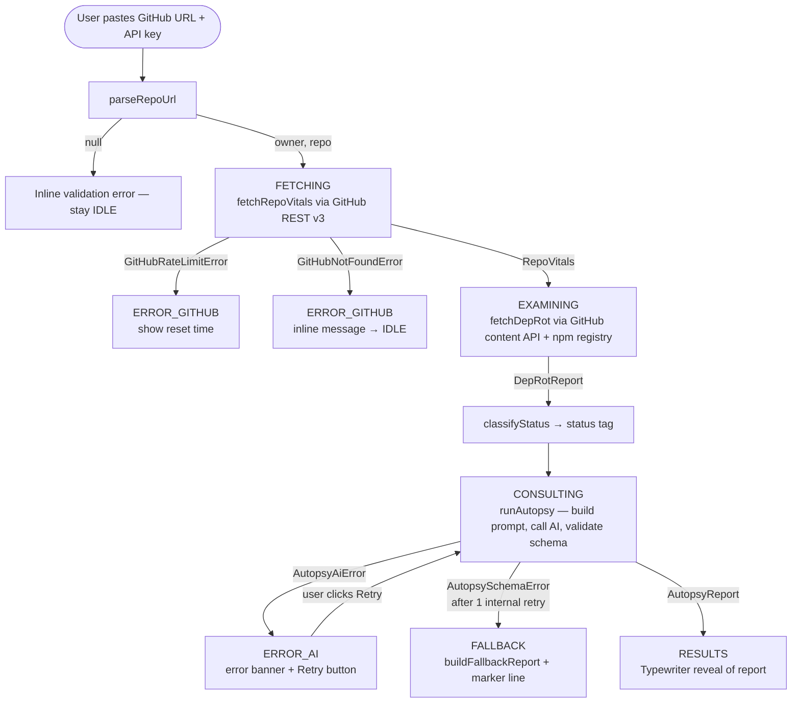
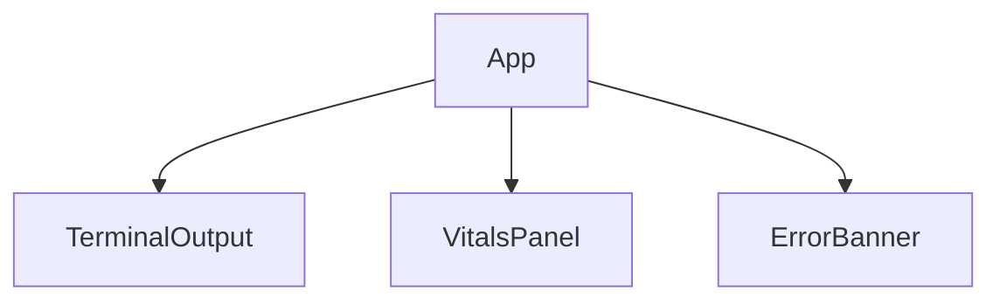

# Design Document

## Overview

Exhume is a single-page React application that takes a GitHub repository URL, fetches objective health signals from the GitHub REST API and npm registry, calls an AI provider to generate a cause-of-death analysis and revival plan, and presents everything through a haunted-terminal aesthetic. There is no backend server; every network call originates in the browser.

The design is structured around a strict state machine that makes every loading and error condition explicit, a small set of pure-function modules that are independently testable, and a thin UI layer that reads from the current state and renders accordingly.

---

## Architecture

### Module Map

| File | Status | Purpose |
|---|---|---|
| `src/App.tsx` | replace | Orchestrates the state machine; conditionally renders all panels |
| `src/github/parseRepoUrl.ts` | create | Parses any common GitHub URL form into `{owner, repo}` |
| `src/github/classifyStatus.ts` | create | Pure function: maps `RepoVitals` → `'DEAD' \| 'DYING' \| 'ALIVE'` |
| `src/github/client.ts` | create | Fetches `RepoVitals` from the GitHub REST v3 API |
| `src/github/deps.ts` | create | Fetches `DepRotReport` by reading `package.json` and querying npm |
| `src/ai/provider.ts` | create | Exports `INFERENCE_MODE` and `runAutopsy()`; owns the full AI call lifecycle |
| `src/ai/schema.ts` | create | Zod schema `autopsyReportSchema`; validates the AI JSON response |
| `src/ai/fallback.ts` | create | `buildFallbackReport()`: deterministic `AutopsyReport` from vitals + deps |
| `src/errors.ts` | create | Typed error classes: `GitHubRateLimitError`, `GitHubNotFoundError`, `AutopsyAiError`, `AutopsySchemaError` |
| `src/ui/TerminalOutput.tsx` | create | Renders progress lines and final report in a monospace block; typewriter effect |
| `src/ui/VitalsPanel.tsx` | create | Compact, always-visible table of `RepoVitals` once loaded |
| `src/ui/ErrorBanner.tsx` | create | Error message display; shows Retry button for `AutopsyAiError` |
| `src/github/__tests__/parseRepoUrl.pbt.ts` | create | Property-based tests for `parseRepoUrl` using fast-check |
| `src/github/__tests__/classifyStatus.pbt.ts` | create | Property-based tests for `classifyStatus` using fast-check |

### Data Flow



---

## State Machine

### States

| State | Payload | Description |
|---|---|---|
| `IDLE` | — | Initial state; URL input and API key input are shown |
| `FETCHING` | — | GitHub REST call in flight; first progress line visible |
| `EXAMINING` | `vitals: RepoVitals` | npm registry queries in flight; vitals panel visible |
| `CONSULTING` | `vitals: RepoVitals, depRot: DepRotReport` | AI call in flight; all data collected, sending to provider |
| `RESULTS` | `vitals: RepoVitals, depRot: DepRotReport, report: AutopsyReport` | Complete; typewriter reveal active |
| `ERROR_GITHUB` | `error: GitHubRateLimitError \| GitHubNotFoundError` | GitHub call failed; no vitals available |
| `ERROR_AI` | `vitals: RepoVitals, depRot: DepRotReport, error: AutopsyAiError` | AI transport failure; vitals remain visible; retry available |
| `FALLBACK` | `vitals: RepoVitals, depRot: DepRotReport, report: AutopsyReport` | Schema validation failed after retry; deterministic summary shown with marker line |

### Transition Table

| From | Event | To | Guard |
|---|---|---|---|
| `IDLE` | User submits valid URL | `FETCHING` | `parseRepoUrl` returns non-null |
| `IDLE` | User submits invalid URL | `IDLE` | `parseRepoUrl` returns null — show inline error |
| `FETCHING` | GitHub fetch succeeds | `EXAMINING` | — |
| `FETCHING` | 403 / 429 from GitHub | `ERROR_GITHUB` | carry `GitHubRateLimitError` |
| `FETCHING` | 404 from GitHub | `ERROR_GITHUB` | carry `GitHubNotFoundError` |
| `EXAMINING` | Dep rot fetch complete | `CONSULTING` | always (DepRotReport has `skipped=true` if no package.json) |
| `CONSULTING` | AI returns valid schema | `RESULTS` | — |
| `CONSULTING` | AI transport / HTTP failure | `ERROR_AI` | carry `AutopsyAiError` |
| `CONSULTING` | Schema mismatch after retry | `FALLBACK` | `buildFallbackReport` synchronously generates report |
| `ERROR_AI` | User clicks Retry | `CONSULTING` | reuse existing `vitals` + `depRot`; no new GitHub fetch |
| `ERROR_GITHUB` | User clicks "Start Over" | `IDLE` | — |
| `RESULTS` | User clicks "Analyse another" | `IDLE` | — |
| `FALLBACK` | User clicks "Analyse another" | `IDLE` | — |

---

## Data Models

```typescript
// src/errors.ts

export class GitHubRateLimitError extends Error {
  readonly resetAt: Date;
  constructor(resetAt: Date) {
    super('GitHub API rate limit exceeded');
    this.name = 'GitHubRateLimitError';
    this.resetAt = resetAt;
  }
}

export class GitHubNotFoundError extends Error {
  constructor(url: string) {
    super(`Repository not found: ${url}`);
    this.name = 'GitHubNotFoundError';
  }
}

export class AutopsyAiError extends Error {
  readonly statusCode?: number;
  constructor(message: string, statusCode?: number) {
    super(message);
    this.name = 'AutopsyAiError';
    this.statusCode = statusCode;
  }
}

export class AutopsySchemaError extends Error {
  constructor(raw: unknown) {
    super('AI response did not match expected schema');
    this.name = 'AutopsySchemaError';
  }
}
```

```typescript
// src/github/client.ts (types)

export interface RepoVitals {
  lastPushDate: string;         // ISO 8601
  archived: boolean;
  openIssueCount: number;
  starCount: number;
  monthsSinceLastPush: number;  // integer, computed at fetch time
}
```

```typescript
// src/github/deps.ts (types)

export interface OutdatedDep {
  name: string;
  current: string;    // version range from package.json, e.g. "^17.0.0"
  latest: string;     // version string from npm registry, e.g. "18.3.1"
  majorsBehind: number;
}

export interface DepRotReport {
  packageName: string;
  dependenciesChecked: number;
  outdatedDeps: OutdatedDep[];
  skipped: boolean;
  skipReason: string | undefined;
}
```

```typescript
// src/ai/provider.ts (types)

export interface RevivalStep {
  order: number;
  action: string;
  rationale: string;
}

export interface AutopsyReport {
  causeOfDeath: string;
  severity: 'critical' | 'serious' | 'stable';
  steps: RevivalStep[];          // 3–7 items, order 1..N contiguous
  generatedAt: string;           // ISO 8601
}
```

```typescript
// App state discriminated union

type AppState =
  | { stage: 'IDLE' }
  | { stage: 'FETCHING' }
  | { stage: 'EXAMINING'; vitals: RepoVitals }
  | { stage: 'CONSULTING'; vitals: RepoVitals; depRot: DepRotReport }
  | { stage: 'RESULTS'; vitals: RepoVitals; depRot: DepRotReport; report: AutopsyReport }
  | { stage: 'ERROR_GITHUB'; error: GitHubRateLimitError | GitHubNotFoundError }
  | { stage: 'ERROR_AI'; vitals: RepoVitals; depRot: DepRotReport; error: AutopsyAiError }
  | { stage: 'FALLBACK'; vitals: RepoVitals; depRot: DepRotReport; report: AutopsyReport };
```

---

## Module Design

### `src/github/parseRepoUrl.ts`

**Export:** `parseRepoUrl(input: string): { owner: string; repo: string } | null`

Accepts any of the following forms:
- `https://github.com/owner/repo`
- `https://github.com/owner/repo.git`
- `https://github.com/owner/repo/`
- `https://github.com/owner/repo/tree/main/some/path`
- `git@github.com:owner/repo.git`

Algorithm:
1. Trim whitespace.
2. Try matching the HTTPS pattern: `^https?://github\.com/([^/]+)/([^/.]+)(?:\.git)?(?:/.*)?$`
3. Try matching the SSH pattern: `^git@github\.com:([^/]+)/([^/.]+)(?:\.git)?$`
4. If neither matches, return `null`.
5. Strip `.git` suffix from the repo segment if present.
6. Return `{ owner, repo }`.

The function is pure with no side effects.

---

### `src/github/classifyStatus.ts`

**Export:** `classifyStatus(vitals: RepoVitals): 'DEAD' | 'DYING' | 'ALIVE'`

Logic (evaluated in order):
1. If `vitals.archived === true` OR `vitals.monthsSinceLastPush >= 24` → `'DEAD'`
2. If `vitals.monthsSinceLastPush >= 12` → `'DYING'`
3. Otherwise → `'ALIVE'`

The function is pure and total — every valid `RepoVitals` maps to exactly one result.

---

### `src/github/client.ts`

**Export:** `fetchRepoVitals(owner: string, repo: string): Promise<RepoVitals>`

Steps:
1. `GET https://api.github.com/repos/{owner}/{repo}` with `Accept: application/vnd.github+json`.
2. On 403 or 429: read the `X-RateLimit-Reset` header (Unix epoch seconds), construct and throw `GitHubRateLimitError(new Date(resetAt * 1000))`.
3. On 404: throw `GitHubNotFoundError`.
4. On any other non-2xx: throw `Error` with status code in message.
5. Map response fields:
   - `pushed_at` → `lastPushDate` (ISO string, as returned)
   - `archived` → `archived`
   - `open_issues_count` → `openIssueCount`
   - `stargazers_count` → `starCount`
   - Compute `monthsSinceLastPush`: `Math.floor((Date.now() - new Date(pushed_at).getTime()) / (1000 * 60 * 60 * 24 * 30.44))`

No authentication headers are added; the user's API key is not used at this layer (it is used only for the AI call).

---

### `src/github/deps.ts`

**Export:** `fetchDepRot(owner: string, repo: string): Promise<DepRotReport>`

Steps:
1. `GET https://api.github.com/repos/{owner}/{repo}/contents/package.json`
2. If 404: return `{ packageName: '', dependenciesChecked: 0, outdatedDeps: [], skipped: true, skipReason: 'No package.json found at repository root' }`.
3. Decode the base64 `content` field; parse as JSON.
4. Merge `dependencies` and `devDependencies` into a single map.
5. For each dependency, `GET https://registry.npmjs.org/{name}/latest` to retrieve the latest version.
6. Parse the current version range (strip leading `^`, `~`, `>=`, etc.) to extract the major version number.
7. Compute `majorsBehind = latestMajor - currentMajor`. Ignore packages where `majorsBehind <= 0`.
8. Return the full `DepRotReport`.

Failed npm fetches for individual packages are silently skipped (do not fail the whole report).

---

### `src/ai/schema.ts`

**Export:** `autopsyReportSchema` (Zod schema)

```typescript
import { z } from 'zod';

export const revivalStepSchema = z.object({
  order: z.number().int().positive(),
  action: z.string().min(1),
  rationale: z.string().min(1),
});

export const autopsyReportSchema = z.object({
  causeOfDeath: z.string().min(1),
  severity: z.enum(['critical', 'serious', 'stable']),
  steps: z.array(revivalStepSchema).min(3).max(7),
});
```

Validation is applied to the parsed JSON response before constructing the full `AutopsyReport` (the `generatedAt` field is added by `provider.ts` after successful validation, not expected from the AI).

---

### `src/ai/provider.ts`

**Exports:**
- `INFERENCE_MODE: 'cloud'` (constant)
- `runAutopsy(vitals: RepoVitals, depRot: DepRotReport, apiKey: string): Promise<AutopsyReport>`

`runAutopsy` algorithm:
1. Build a prompt (see AI Prompt Contract section).
2. Call the AI provider HTTP endpoint with the user's `apiKey` in the `Authorization` header. No key touches localStorage, cookies, or environment variables.
3. If the HTTP call fails (network error, non-2xx): throw `AutopsyAiError`.
4. Parse the response body as JSON. Apply `autopsyReportSchema.safeParse()`.
5. If validation fails: retry once (repeat steps 2–4).
6. If validation fails again: throw `AutopsySchemaError`.
7. If validation succeeds: return `{ ...parsedData, generatedAt: new Date().toISOString() }`.

---

### `src/ai/fallback.ts`

**Export:** `buildFallbackReport(vitals: RepoVitals, depRot: DepRotReport): AutopsyReport`

See the [Deterministic Fallback](#deterministic-fallback) section for the full algorithm.

---

### `src/ui/TerminalOutput.tsx`

**Props:**
```typescript
interface TerminalOutputProps {
  lines: string[];
  typewriterActive: boolean;
}
```

**Behaviour:**
- Renders inside a `<pre>` element styled with `--mono` and `--bg` variables from `index.css`.
- When `typewriterActive` is `true` and `prefers-reduced-motion` does not match `reduce`: reveals lines one character at a time using a CSS animation or `setInterval`. Each new line starts after the previous line finishes.
- When `prefers-reduced-motion: reduce` is detected via `window.matchMedia('(prefers-reduced-motion: reduce)')`: renders all lines immediately with no animation.
- When `typewriterActive` is `false`: renders all lines immediately.

---

### `src/ui/VitalsPanel.tsx`

**Props:**
```typescript
interface VitalsPanelProps {
  vitals: RepoVitals;
  status: 'DEAD' | 'DYING' | 'ALIVE';
}
```

**Behaviour:**
- Renders a compact table (or definition list) using `--accent` for the status badge and `--border` for table borders.
- Displayed fields: last push date (formatted as `YYYY-MM-DD`), archived flag, open issue count, star count, months since last push, and the status classification badge.
- Visible in states: `EXAMINING`, `CONSULTING`, `RESULTS`, `ERROR_AI`, `FALLBACK`.

---

### `src/ui/ErrorBanner.tsx`

**Props:**
```typescript
interface ErrorBannerProps {
  error: GitHubRateLimitError | GitHubNotFoundError | AutopsyAiError;
  onRetry?: () => void;  // only provided for AutopsyAiError
}
```

**Behaviour:**
- Renders a banner using `--accent` colour with an `⚠` prefix.
- For `GitHubRateLimitError`: displays the reset time and a link to `https://docs.github.com/en/rest/using-the-rest-api/rate-limits-for-the-rest-api`.
- For `GitHubNotFoundError`: displays the not-found message; no retry offered.
- For `AutopsyAiError`: displays the error message and a "Retry" button that calls `onRetry`.

---

### `src/App.tsx`

**Responsibilities:**
- Holds the single `appState: AppState` value via `useState`.
- Holds `apiKey: string` in component state (never persisted).
- Provides `handleSubmit` which: parses the URL, transitions to `FETCHING`, calls `fetchRepoVitals`, then `fetchDepRot`, then `runAutopsy`.
- Provides `handleRetry` which: transitions from `ERROR_AI` back to `CONSULTING` using existing `vitals` and `depRot`, calls `runAutopsy` again.
- Catches errors from each async step and transitions to the appropriate error state.
- Calls `buildFallbackReport` and transitions to `FALLBACK` when `AutopsySchemaError` is caught.
- Renders:
  - URL input + API key input (always, in `IDLE`)
  - `TerminalOutput` with stage-appropriate lines (all non-IDLE states)
  - `VitalsPanel` once vitals are available
  - `ErrorBanner` in `ERROR_GITHUB` and `ERROR_AI`
  - Fallback marker line `"the spirits are silent — showing instrument readings only."` in `FALLBACK`

---

## Components and Interfaces

### Component Tree



`App` is the single stateful component. `TerminalOutput`, `VitalsPanel`, and `ErrorBanner` are stateless presentational components that receive data and callbacks as props.

### Interface Summary

| Component / Module | Exported interface | Consumed by |
|---|---|---|
| `parseRepoUrl` | `(input: string) => { owner, repo } \| null` | `App` |
| `classifyStatus` | `(vitals: RepoVitals) => 'DEAD' \| 'DYING' \| 'ALIVE'` | `App`, `VitalsPanel`, `buildFallbackReport` |
| `fetchRepoVitals` | `(owner, repo) => Promise<RepoVitals>` | `App` |
| `fetchDepRot` | `(owner, repo) => Promise<DepRotReport>` | `App` |
| `runAutopsy` | `(vitals, depRot, apiKey) => Promise<AutopsyReport>` | `App` |
| `buildFallbackReport` | `(vitals, depRot) => AutopsyReport` | `App` |
| `autopsyReportSchema` | Zod schema | `provider.ts` |
| `TerminalOutput` | `{ lines: string[], typewriterActive: boolean }` | `App` |
| `VitalsPanel` | `{ vitals: RepoVitals, status: 'DEAD' \| 'DYING' \| 'ALIVE' }` | `App` |
| `ErrorBanner` | `{ error, onRetry? }` | `App` |

No component communicates with another component directly — all data flows through `App` state.

---

## AI Prompt Contract

### Input sent to the AI

```json
{
  "vitals": {
    "lastPushDate": "2021-03-15T10:22:00Z",
    "archived": false,
    "openIssueCount": 142,
    "starCount": 831,
    "monthsSinceLastPush": 50
  },
  "deps": {
    "packageName": "example-pkg",
    "dependenciesChecked": 18,
    "outdatedDeps": [
      { "name": "react", "current": "^17.0.0", "latest": "19.1.0", "majorsBehind": 2 }
    ],
    "skipped": false,
    "skipReason": null
  }
}
```

No source code, no file trees, no commit messages. Only the structured data above.

### System prompt excerpt

> You are a software archaeologist. Given vital signs and dependency rot data for a GitHub repository, you will produce a clinical autopsy report as JSON. Do not include any commentary outside the JSON object. Respond only with valid JSON matching this schema:
> `{ "causeOfDeath": string, "severity": "critical"|"serious"|"stable", "steps": [{ "order": number, "action": string, "rationale": string }] }`
> steps must contain 3 to 7 items numbered sequentially from 1.

### Expected output schema

```json
{
  "causeOfDeath": "string",
  "severity": "critical" | "serious" | "stable",
  "steps": [
    { "order": 1, "action": "string", "rationale": "string" },
    ...
  ]
}
```

The `generatedAt` timestamp is appended by `provider.ts` after successful validation.

---

## Deterministic Fallback

`buildFallbackReport(vitals: RepoVitals, depRot: DepRotReport): AutopsyReport` runs synchronously with no network calls and never throws.

### Algorithm

1. **Determine severity** from `classifyStatus`:
   - `'DEAD'` → `severity: 'critical'`
   - `'DYING'` → `severity: 'serious'`
   - `'ALIVE'` → `severity: 'stable'`

2. **Build cause of death string**:
   - If `vitals.archived`: `"Repository has been archived by its owner."`
   - Else if `vitals.monthsSinceLastPush >= 24`: `"No commits in ${vitals.monthsSinceLastPush} months."`
   - Else if `vitals.monthsSinceLastPush >= 12`: `"Activity has stalled for ${vitals.monthsSinceLastPush} months."`
   - Else: `"Repository appears active but shows signs of dependency rot."`

3. **Build steps** (always produces exactly 3 steps, satisfying the 3–7 constraint):
   - Step 1: `{ order: 1, action: "Assess community interest", rationale: "Star count (${vitals.starCount}) and ${vitals.openIssueCount} open issues indicate the level of ongoing demand." }`
   - Step 2 (conditional on `!depRot.skipped && depRot.outdatedDeps.length > 0`): `{ order: 2, action: "Upgrade ${depRot.outdatedDeps.length} outdated dependencies", rationale: "Dependencies are behind by up to ${Math.max(...depRot.outdatedDeps.map(d => d.majorsBehind))} major versions." }` — otherwise `{ order: 2, action: "Audit the dependency tree", rationale: "No package.json analysis was available; a manual audit is needed." }`
   - Step 3: `{ order: 3, action: "File a maintainership issue or fork", rationale: "If no active maintainer responds within 30 days, a community fork is the most reliable revival path." }`

4. Return `{ causeOfDeath, severity, steps, generatedAt: new Date().toISOString() }`.

---

## Error Taxonomy

| Error class | Trigger | UI behaviour |
|---|---|---|
| `GitHubRateLimitError` | 403 or 429 from GitHub API | Transition to `ERROR_GITHUB`; `ErrorBanner` shows reset time and link to GitHub rate-limit docs |
| `GitHubNotFoundError` | 404 from GitHub API | Transition to `ERROR_GITHUB`; `ErrorBanner` shows not-found message; "Start Over" returns to `IDLE` |
| `AutopsyAiError` | Transport / HTTP failure from AI provider | Transition to `ERROR_AI`; `ErrorBanner` shows message + Retry button; vitals remain visible in `VitalsPanel` |
| `AutopsySchemaError` | AI JSON fails schema validation after one automatic internal retry | Transition to `FALLBACK`; `buildFallbackReport` runs synchronously; marker line *"the spirits are silent — showing instrument readings only."* displayed above the report |

---

## Error Handling

### GitHub fetch errors

`fetchRepoVitals` and `fetchDepRot` both use the GitHub REST v3 API without authentication. The error cases are:

- **403 / 429 (rate limit):** Read `X-RateLimit-Reset` header (Unix epoch seconds). Throw `GitHubRateLimitError(new Date(resetAt * 1000))`. `App` transitions to `ERROR_GITHUB` and renders `ErrorBanner` with the reset time and a documentation link.
- **404 (not found):** Throw `GitHubNotFoundError`. `App` transitions to `ERROR_GITHUB` and renders `ErrorBanner` with the not-found message. The user can return to `IDLE` to try a different URL.
- **Other non-2xx:** Throw a generic `Error` with the status code included. `App` transitions to `ERROR_GITHUB`.
- **Network failure:** The `fetch` rejection propagates as-is. `App` treats it as `ERROR_GITHUB`.

`fetchDepRot` additionally handles 404 from the GitHub contents API gracefully (not as an error state) — it returns a `DepRotReport` with `skipped: true`. Individual npm registry fetch failures per package are swallowed silently; that package is omitted from `outdatedDeps`.

### AI call errors

`runAutopsy` has two distinct failure modes:

- **Transport / HTTP failure (`AutopsyAiError`):** The user's key may be wrong, the network may be down, or the provider returned a non-2xx status. `App` transitions to `ERROR_AI`, keeps `vitals` and `depRot` in state, and renders `ErrorBanner` with a Retry button. Clicking Retry re-enters `CONSULTING` with the existing data — no GitHub re-fetch.
- **Schema mismatch after retry (`AutopsySchemaError`):** The AI returned parseable JSON but it did not match `autopsyReportSchema` on two consecutive attempts. `runAutopsy` throws `AutopsySchemaError`. `App` calls `buildFallbackReport` synchronously and transitions to `FALLBACK`. The report is displayed normally, with the additional marker line *"the spirits are silent — showing instrument readings only."* prepended in `TerminalOutput`.

### Error boundaries

No React error boundary is added for the MVP. All async errors are caught explicitly in `App`'s `handleSubmit` and `handleRetry` functions using `try/catch`. Unhandled errors will surface in the browser console and leave the app in its current state without crashing the full page.

---

## Correctness Properties

*A property is a characteristic or behavior that should hold true across all valid executions of a system — essentially, a formal statement about what the system should do. Properties serve as the bridge between human-readable specifications and machine-verifiable correctness guarantees.*

### Property 1: parseRepoUrl returns null for non-GitHub inputs

*For any* string that is not a valid GitHub repository URL (does not contain `github.com` as the host with a valid owner/repo path), `parseRepoUrl` SHALL return `null`.

**Validates: Requirements 1.2**

### Property 2: parseRepoUrl extracts consistent owner and repo across URL variants

*For any* valid owner and repo name pair, all syntactic variants of the GitHub URL (with or without `.git`, with or without trailing slash, with or without extra path segments, HTTPS or SSH form) SHALL produce the same `{owner, repo}` pair from `parseRepoUrl`.

**Validates: Requirements 1.1**

### Property 3: classifyStatus is total

*For any* `RepoVitals` value with a non-negative `monthsSinceLastPush`, `classifyStatus` SHALL return exactly one of `'DEAD'`, `'DYING'`, or `'ALIVE'` — it never throws and never returns any other value.

**Validates: Requirements 2.4**

### Property 4: classifyStatus returns DEAD for archived or old repositories

*For any* `RepoVitals` where `archived === true` OR `monthsSinceLastPush >= 24`, `classifyStatus` SHALL return `'DEAD'`.

**Validates: Requirements 2.2**

### Property 5: classifyStatus returns DYING for stale repositories

*For any* `RepoVitals` where `archived === false` AND `monthsSinceLastPush >= 12` AND `monthsSinceLastPush < 24`, `classifyStatus` SHALL return `'DYING'`.

**Validates: Requirements 2.3**

### Property 6: classifyStatus returns ALIVE for recent repositories

*For any* `RepoVitals` where `archived === false` AND `monthsSinceLastPush < 12`, `classifyStatus` SHALL return `'ALIVE'`.

**Validates: Requirements 2.3**

### Property 7: classifyStatus is deterministic

*For any* `RepoVitals`, calling `classifyStatus` twice with identical inputs SHALL return the same result.

**Validates: Requirements 2.4**

### Property 8: Fallback report is always constructible

*For any* `RepoVitals` and `DepRotReport`, `buildFallbackReport` SHALL return a valid `AutopsyReport` synchronously without throwing, with `steps.length` between 3 and 7 and all `order` values forming a contiguous sequence starting at 1.

**Validates: Requirements 4.2**

### Property 9: AutopsyReport steps are strictly ordered

*For any* `AutopsyReport` (from AI or fallback), the `steps` array SHALL have `order` values forming the sequence `1, 2, ..., N` with no gaps, no duplicates, and `3 ≤ N ≤ 7`.

**Validates: Requirements 4.1**

---

## Testing Strategy

### Unit Tests (example-based)

Unit tests use Vitest (`vitest --run`). They cover:

- `parseRepoUrl`: concrete valid and invalid URL examples (empty string, plain text, `ftp://` scheme, URL with correct host but no repo segment).
- `classifyStatus`: boundary values — `monthsSinceLastPush` of 11, 12, 23, 24, and `archived` flag combinations.
- `fetchRepoVitals`: mocked `fetch` responses for 200, 403, 404, 429 — verify correct mapping and correct error types.
- `fetchDepRot`: mocked GitHub content API 200 (with package.json) and 404; mocked npm registry responses — verify `majorsBehind` computation and graceful skip.
- `runAutopsy`: mocked AI responses — valid on first call, schema failure then success, schema failure twice (verify `AutopsySchemaError`), transport failure (verify `AutopsyAiError`).
- `buildFallbackReport`: representative vitals covering each severity level — verify report structure.
- `ErrorBanner`, `VitalsPanel`, `TerminalOutput`: React Testing Library snapshot / assertion tests.

### Property-Based Tests (fast-check)

Property tests use fast-check with a minimum of 100 iterations per property. Each test references its design property in a comment.

**`src/github/__tests__/parseRepoUrl.pbt.ts`**

```
// Feature: autopsy-core, Property 1: parseRepoUrl returns null for non-GitHub inputs
fc.assert(fc.property(fc.string(), (s) => {
  if (isValidGitHubUrl(s)) return; // filter out accidentally valid URLs
  expect(parseRepoUrl(s)).toBeNull();
}));

// Feature: autopsy-core, Property 2: parseRepoUrl extracts consistent owner and repo across URL variants
fc.assert(fc.property(validOwnerRepoArb, ({ owner, repo }) => {
  const variants = buildUrlVariants(owner, repo); // https, https+.git, https+slash, ssh, ssh+.git
  const results = variants.map(parseRepoUrl).filter(Boolean);
  expect(results.length).toBe(variants.length);
  results.forEach(r => {
    expect(r!.owner).toBe(owner);
    expect(r!.repo).toBe(repo);
  });
}));
```

**`src/github/__tests__/classifyStatus.pbt.ts`**

```
// Feature: autopsy-core, Property 3: classifyStatus is total
fc.assert(fc.property(repoVitalsArb, (vitals) => {
  const result = classifyStatus(vitals);
  expect(['DEAD', 'DYING', 'ALIVE']).toContain(result);
}));

// Feature: autopsy-core, Property 4: classifyStatus returns DEAD for archived or old
fc.assert(fc.property(deadVitalsArb, (vitals) => {
  expect(classifyStatus(vitals)).toBe('DEAD');
}));

// Feature: autopsy-core, Property 5: classifyStatus returns DYING for stale
fc.assert(fc.property(dyingVitalsArb, (vitals) => {
  expect(classifyStatus(vitals)).toBe('DYING');
}));

// Feature: autopsy-core, Property 6: classifyStatus returns ALIVE for recent
fc.assert(fc.property(aliveVitalsArb, (vitals) => {
  expect(classifyStatus(vitals)).toBe('ALIVE');
}));

// Feature: autopsy-core, Property 7: classifyStatus is deterministic
fc.assert(fc.property(repoVitalsArb, (vitals) => {
  expect(classifyStatus(vitals)).toBe(classifyStatus(vitals));
}));
```

Arbitraries `deadVitalsArb`, `dyingVitalsArb`, `aliveVitalsArb`, and `repoVitalsArb` are defined in a shared `__tests__/arbitraries.ts` file. They generate `RepoVitals` objects with constrained `monthsSinceLastPush` ranges and `archived` values matching each classification boundary.

### Integration Tests

- End-to-end scenario with real GitHub API (rate-limited; run only in CI with token): verify `fetchRepoVitals` returns all five fields for a known public repo.
- Verify the AI prompt sent by `runAutopsy` contains only `vitals` and `deps` keys — no source code fields.

### Accessibility

- `TerminalOutput` respects `prefers-reduced-motion: reduce` — verified by mocking `window.matchMedia` in Vitest.
- All interactive elements (Retry button, Start Over button) have accessible labels.
