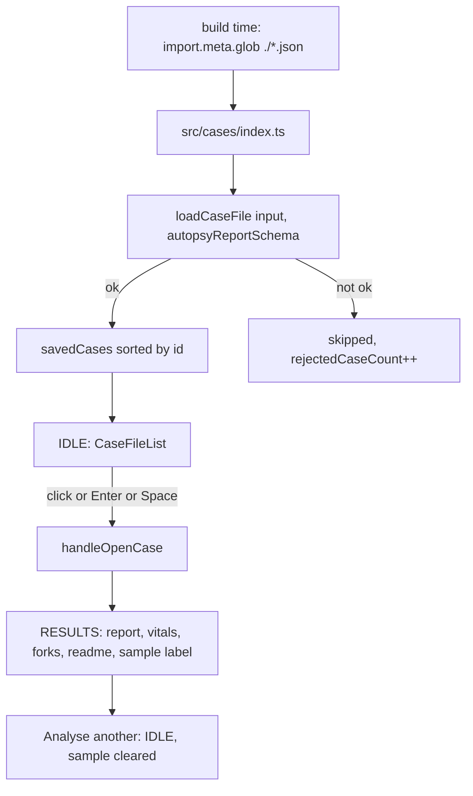

# Design Document

## Overview

This design adds saved case files on top of autopsy-core, revival-extras and readme-explainer. A case file is one static JSON document holding a frozen analysis. A "Saved case files" list on the start screen opens one sample straight into RESULTS with no network request, no GitHub call and no AI call. The sample is shown through the existing panels under a "saved sample" label.

Parts:

1. **Pure loader** `src/lib/caseFile.ts`: validates unknown JSON into a typed `CaseFile` or returns a reason. It never throws and does no I/O.
2. **Case data** `src/cases/*.json` plus `src/cases/index.ts`: Vite bundles every JSON file at build time with `import.meta.glob`. The index passes each file through the loader.
3. **UI** `CaseFileList` and `SampleLabel`, a few CSS rules, and a small wiring change in `src/App.tsx`.

No new dependencies, no backend, no accounts, no property-based tests. The state machine is unchanged: opening a case is an additive IDLE -> RESULTS entry (approved).

### Phased delivery (conflict with requirements 1.1, 1.7 and part of 1.8)

Requirements 1.1 (2 to 3 case files), 1.7 (a DEAD repository with a living fork and an overview) and part of 1.8 (the mix of statuses across the set) can only be fully satisfied once a real DEAD case exists. The project owner decided:

- **Phase 1 (the tasks in this spec)** ships ONE fictional placeholder case and all machinery: loader, bundling, list, label, wiring, tests. The loader and the list work for any count from 1 to 3.
- **Phase 2 (a later task, created when the user pastes the real report text)** adds the real DEAD case with a living fork and an overview as one more JSON file in `src/cases/`, and optionally a second one. Phase 2 closes 1.1 and 1.7. No code change is expected, because the index picks up new files.

`requirements.md` is approved and is not edited. Until phase 2, the checkpoint cannot claim Requirements 1.1 and 1.7. Requirement 1.8 is satisfied by the placeholder (ALIVE) for its own text, and is complete as a set only in phase 2. Requirement 1.9 is satisfied by the placeholder (ALIVE, 7 months, HIBERNATING).

### Placeholder case decision

Fictional data must not produce misleading links. The placeholder is therefore:

- Repository `lanternworks/lantern`, `source.kind` `fictional`, `source.readmeOrigin` `written-for-sample`, `license` `Apache-2.0` (the sample text is part of this project).
- ALIVE with 7 months since the last push, so the label is HIBERNATING. Severity `stable`.
- `forks: { "status": "skipped" }`, so ForksPanel renders nothing and no fork link exists.
- `causeOfDeath` says what to watch (the existing rule for ALIVE). Three steps, each citing a concrete value. An overview. A short README excerpt written for the sample.
- No "exhume" in owner or repo. No claim about any real repository.

**Open question 1 (README link).** ReadmePanel always renders the link built by `buildReadmeUrl(owner, repo)`, which for the placeholder is `https://github.com/lanternworks/lantern#readme`. That page may return 404 or belong to a stranger. The checkpoint asks the user to open `https://github.com/lanternworks/lantern` once and confirm it does not exist, or to pick other names.

**Open question 2 (own repository).** The user's own repository `codergani/exhume` would break the accessible-name rule (see Constraints), because its button text would contain "exhume". The own-repository case must use another repository, or the user must accept a different accessible-name format. This is not needed in phase 1.

---

## Architecture

### Module Map

| File | Status | Purpose |
|---|---|---|
| `src/lib/caseFile.ts` | create | Pure: types, `loadCaseFile`, `ReportValidator` |
| `src/cases/placeholder-lantern.json` | create | The fictional placeholder case |
| `src/cases/index.ts` | create | Bundles `./*.json`, runs the loader, exports `savedCases` and `rejectedCaseCount` |
| `src/ui/CaseFileList.tsx` | create | The "Saved case files" list |
| `src/ui/SampleLabel.tsx` | create | The "saved sample" note |
| `src/ui/theme.css` | modify | Append rules for `.cases` and `.sample-label`; no existing rule changes |
| `src/App.tsx` | modify | `sample` state, `handleOpenCase`, render the list in IDLE and the label above VitalsPanel |

Untouched: `src/appState.ts`, `src/ai/*`, `src/github/*`, `src/lib/*` other than the new file, `VitalsPanel`, `ForksPanel`, `ReadmePanel`, `TerminalOutput`, `lines.ts`, all existing tests (tests are only appended to `tests/App.test.tsx`).

### Requirement-to-component map

| Requirement | Covered by | Phase |
|---|---|---|
| 1.1 (2 to 3 cases) | `src/cases/*.json` | Deferred to phase 2 (phase 1 ships 1) |
| 1.2 to 1.6 (fields) | `CaseFile` type, `loadCaseFile`, placeholder JSON | Phase 1 |
| 1.7 (DEAD with living fork and overview) | real case JSON | Deferred to phase 2 |
| 1.8 (DYING or ALIVE) | placeholder (ALIVE) | Partly deferred (set is complete in phase 2) |
| 1.9 (HIBERNATING sample) | placeholder (ALIVE, 7 months) | Phase 1 |
| 1.10, 1.11 (fictional or real, `source`) | `CaseSource`, placeholder JSON, `tests/cases.test.ts` | Phase 1 |
| 2.1 to 2.14 (loader) | `src/lib/caseFile.ts` | Phase 1 |
| 2.15, 2.16 (loader tests, shipped-case test) | `tests/caseFile.test.ts`, `tests/cases.test.ts` | Phase 1 |
| 3.1 to 3.8 (list) | `CaseFileList`, `src/cases/index.ts`, `App.tsx` | Phase 1 |
| 4.1 to 4.12 (loading) | `handleOpenCase`, `handleReset`, existing panels | Phase 1 |
| 5.1 to 5.6 (label) | `SampleLabel`, `App.tsx` | Phase 1 |
| 6.1 to 6.5 (safety, accessibility) | text nodes only, existing panels, native buttons | Phase 1 |
| 7.1 to 7.8 (constraints) | whole design, `tests/cases.test.ts`, appended App tests | Phase 1 |

### Data Flow



---

## Components and Interfaces

### `src/lib/caseFile.ts`

Pure. Imports `ForkResult` and `ForkCandidate` types from `./forks`, and `README_MAX_CHARS` from `./readme`. Imports nothing from `src/ui`, `src/github` or `src/ai` and has no Zod import (Requirement 2.2).

```typescript
import type { ForkResult } from './forks'

/** Structurally identical to RepoVitals in src/github/client.ts (lib may not import src/github). */
export interface CaseVitals {
  lastPushDate: string
  archived: boolean
  openIssueCount: number
  starCount: number
  monthsSinceLastPush: number
}

export interface CaseReport {
  causeOfDeath: string
  severity: 'critical' | 'serious' | 'stable'
  steps: Array<{ order: number; action: string; rationale: string }>   // same shape as RevivalStep in src/ai/fallback.ts
  generatedAt: string
  recommendation?: { kind: 'adopt-fork' | 'revive-original'; fork?: string; reason: string }   // validated by the injected schema
  overview?: { purpose: string; audience: string; quickStart: string[] }
}

export interface CaseSource {
  kind: 'fictional' | 'captured'
  readmeOrigin: 'written-for-sample' | 'from-repository'
  repository?: string   // 'owner/repo', required when readmeOrigin is 'from-repository'
}

export interface CaseFile {
  id: string
  owner: string
  repo: string
  capturedAt: string
  license: string
  source: CaseSource
  vitals: CaseVitals
  forks: Extract<ForkResult, { status: 'available' | 'skipped' }>
  readme: { text: string; truncated: boolean }
  report: CaseReport
}

export type CaseLoadResult = { ok: true; case: CaseFile } | { ok: false; reason: string }

/** The minimal surface of a Zod schema; the caller injects autopsyReportSchema. */
export interface ReportValidator<T> {
  safeParse(input: unknown): { success: true; data: T } | { success: false }
}

export function loadCaseFile(
  input: unknown,
  validateReport: ReportValidator<Omit<CaseReport, 'generatedAt'>>,
): CaseLoadResult
```

The implementer reads the real step and recommendation types from `src/ai/fallback.ts` and mirrors them structurally in `CaseReport`, with no import from `src/ai`. `recommendation` stays loosely typed in `src/lib`; `src/cases/index.ts` is the only place that binds the real schema.

**Rules** (Requirement 2, in this order; the first failure returns):

1. The whole body is in `try { ... } catch { return { ok: false, reason: 'unreadable case file' } }`. The function never throws.
2. `input` must be a non-null, non-array object; otherwise `{ ok: false, reason: 'not a case file' }`.
3. `id` matches `^[a-z0-9-]{1,40}$`. `owner` and `repo` are non-empty strings matching `^[A-Za-z0-9._-]{1,100}$`. `license` is a non-empty string after trim.
4. Dates: `capturedAt`, `vitals.lastPushDate`, every fork `lastPushDate` and `report.generatedAt` must match `^\d{4}-\d{2}-\d{2}T\d{2}:\d{2}(:\d{2}(\.\d{1,3})?)?(Z|[+-]\d{2}:\d{2})$` AND `!Number.isNaN(Date.parse(s))`.
5. `vitals`: `archived` is a boolean; `monthsSinceLastPush`, `openIssueCount`, `starCount` are non-negative integers (`Number.isInteger(n) && n >= 0`). No recomputation from any clock.
6. `forks.status` is `'skipped'` or `'available'`. `'available'` needs `living` as an array of at most 3 entries, `inspected` and `livingTotal` non-negative integers, `livingTotal >= living.length` and `inspected >= livingTotal`. Each fork has non-empty-pattern `owner` and `name` (GitHub-safe pattern), `htmlUrl` starting with `https://github.com/`, `starCount` a non-negative integer, `lastPushDate` valid per rule 4 and `archived` a boolean. `'unavailable'` and any other status are rejected.
7. `readme.text` is a string, non-empty after trim, `length <= README_MAX_CHARS`, with no character in U+0000-U+001F other than `\n`, `\r`, `\t` and no U+007F. `readme.truncated` is a boolean.
8. `source.kind` and `source.readmeOrigin` are one of the enum values. When `readmeOrigin` is `'from-repository'`, `source.repository` must be a non-empty `owner/repo` string.
9. The report: `validateReport.safeParse(input.report)`; failure returns `{ ok: false, reason: 'report does not match the schema' }`. This rejects fewer than 3 or more than 7 steps (Requirement 2.12) and, through the existing schema's `.catch(undefined)`, drops a malformed overview alone (Requirement 2.13). Then `generatedAt` is read from `input.report` and checked by rule 4 separately, because the schema does not validate it.
10. The loader builds and returns a NEW object, with new arrays for `living`, `steps` and `quickStart`, so callers cannot mutate shared data. The input is never returned by reference.

Reason strings are short, plain and never include field values. The loader is deterministic: no clock, no randomness (Requirement 2.14).

### `src/cases/placeholder-lantern.json`

The exact values below are the file content (strings shown as written; the file is plain JSON):

- `id`: `placeholder-lantern`
- `owner`: `lanternworks`, `repo`: `lantern`
- `capturedAt`: `2025-06-15T12:00:00Z`
- `license`: `Apache-2.0`
- `source`: `{ "kind": "fictional", "readmeOrigin": "written-for-sample" }`
- `vitals`: `{ "lastPushDate": "2024-11-15T09:30:00Z", "archived": false, "openIssueCount": 4, "starCount": 128, "monthsSinceLastPush": 7 }`
- `forks`: `{ "status": "skipped" }`
- `readme`: `{ "truncated": false, "text": "lantern\n\nA small command-line tool that watches a folder and prints a line each time a file changes.\n\nUsage\n  lantern watch ./notes\n\nOptions\n  --quiet   print only the file name\n  --once    exit after the first change\n\nThis is a fictional sample written for the saved case files." }`
- `report.causeOfDeath`: `Not dead. The last push was 7 months ago and 4 issues are still open. Watch for a push within 12 months, or this repository will be classed DYING.`
- `report.severity`: `stable`
- `report.steps` (3, each with a concrete value; `order` 1 to 3, shown below as `action`: `rationale`):
  1. `Triage the 4 open issues`: `Read all 4 open issues and label each as bug, question or request. Close the ones that are answered.`
  2. `Cut one small release`: `The last push was on 2024-11-15. Publish one patch release so the 7-month gap ends.`
  3. `Set a review date`: `Add a note to check this repository again before 12 months pass, which is the DYING threshold.`
  (Each step is `{ "order": N, "action": "...", "rationale": "..." }`, the `RevivalStep` shape in `src/ai/fallback.ts`.)
- `report.generatedAt`: `2025-06-15T12:00:05Z`
- `report.overview`: `{ "purpose": "Watches a folder and prints a line each time a file changes.", "audience": "Developers who want a quick change log of a local folder.", "quickStart": ["Run lantern watch ./notes in a terminal.", "Edit a file in that folder and read the printed line."] }`
- No `recommendation` (no fork exists).

No Markdown links, no HTML, no keys, no emails, nothing personal.

### `src/cases/index.ts`

```typescript
import { autopsyReportSchema } from '../ai/schema'
import { loadCaseFile, type CaseFile } from '../lib/caseFile'

const modules = import.meta.glob('./*.json', { eager: true, import: 'default' }) as Record<string, unknown>

const results = Object.entries(modules)
  .sort(([a], [b]) => a.localeCompare(b))
  .map(([, json]) => loadCaseFile(json, autopsyReportSchema))

/** Valid cases only, sorted by id. */
export const savedCases: CaseFile[] = results
  .flatMap((r) => (r.ok ? [r.case] : []))
  .sort((a, b) => a.id.localeCompare(b.id))

/** Count of files the loader rejected. Used by tests; never logged. */
export const rejectedCaseCount: number = results.filter((r) => !r.ok).length
```

Vite inlines the JSON into the bundle at build time, so there is no runtime request, it works in Vitest, and adding a case needs only a new file. The values are typed `unknown`, so no tsconfig change (such as `resolveJsonModule`) is needed. The index is in `src/cases`, not `src/lib`, because it imports `src/ai/schema` (schema injection, Requirement 2.11: no second copy of the report schema exists). If the `autopsyReportSchema` type does not satisfy `ReportValidator<...>` structurally, the implementer adjusts the generic on the interface, not the schema.

### `src/ui/CaseFileList.tsx`

```typescript
interface CaseFileListProps {
  cases: CaseFile[]
  onOpen: (c: CaseFile) => void
}
```

- Renders `null` when `cases` is empty (Requirement 3.8).
- Otherwise `<section className="cases" aria-labelledby="cases-title"><h2 id="cases-title">Saved case files</h2><ul>...</ul></section>`.
- One `<li>` per case with `<button type="button" onClick={() => onOpen(c)}>`. Native buttons give mouse, Enter and Space activation and keyboard reachability (Requirements 3.6, 6.5).
- Button text, which is also its accessible name: `${owner}/${repo} · ${label} · captured ${capturedAt.slice(0, 10)}`, where `label = statusLabel(classifyStatus(c.vitals), c.vitals.monthsSinceLastPush)`. `CaseVitals` is structurally identical to `RepoVitals`, so `classifyStatus` accepts it.
- The title is a heading, not a button, and the button text never contains the product name, so no name matches `/exhume/i`.
- Plain text nodes only.

### `src/ui/SampleLabel.tsx`

```typescript
interface SampleLabelProps { capturedAt: string; kind: 'fictional' | 'captured' }
```

Renders one `<p className="sample-label" role="note">` with the text `saved sample · frozen snapshot from YYYY-MM-DD, not live data`, plus ` · fictional repository` when `kind` is `fictional`. No timers, no animation, plain text.

### `src/ui/theme.css` (append only)

New rules for `.cases`, `.cases ul` (no bullets, no padding), `.cases li`, `.cases button` (secondary button style, left-aligned, full width, `--crypt-*` colours with readable contrast) and `.sample-label` (border using `--crypt-dim`, readable text on the panel). No transition or animation. No existing rule is altered.

### `src/App.tsx` (modify)

```typescript
import { savedCases } from './cases'
const [sample, setSample] = useState<{ capturedAt: string; kind: 'fictional' | 'captured' } | null>(null)

function handleOpenCase(c: CaseFile) {
  runRef.current++                       // cancels any in-flight run
  setInputError(null)                    // use the existing input-error setter
  setRestingToday(false)
  setForkResult(c.forks)
  setReadmeResult({ status: 'available', text: c.readme.text, truncated: c.readme.truncated, url: buildReadmeUrl(c.owner, c.repo) })
  setSample({ capturedAt: c.capturedAt, kind: c.source.kind })
  setState({ stage: 'RESULTS', vitals: c.vitals, depRot: SKIPPED_DEP_ROT, report: c.report })
}
```

- `handleOpenCase` never calls `fetchRepoVitals`, `fetchForks`, `fetchReadme`, `runAutopsy` or Firebase, and never reads or writes `vitalsCache`, `forksCache` or `readmeCache`. A later real analysis of the same `owner/repo` therefore fetches live data (Requirement 4.11).
- `handleSubmit` and `handleReset` call `setSample(null)` (Requirements 4.12, 5.5).
- Render: `<CaseFileList cases={savedCases} onOpen={handleOpenCase} />` only in IDLE, directly after the URL form and its input error. `<SampleLabel ... />` renders when `sample` is non-null, directly above VitalsPanel.
- The sample shows through the existing report `TerminalOutput` (typewriter, reduced motion respected), VitalsPanel (status from `classifyStatus`, label from `statusLabel`), ForksPanel and ReadmePanel (link from `buildReadmeUrl`, `target="_blank"`, `rel="noopener noreferrer"`).
- No new AppState stage and no changed transition. A sample cannot reach ERROR_GITHUB, ERROR_AI or FALLBACK, because no async work runs.
- The report is passed as is. `CaseReport` is structurally the `AutopsyReport` type; if the compiler needs it, the implementer adds a narrow type assertion at the single call site.

---

## Data Models

`CaseFile`, `CaseVitals`, `CaseReport`, `CaseSource`, `CaseLoadResult` and `ReportValidator` are defined above. `ForkResult` (restricted to `available` and `skipped`), `ForkCandidate` and `ReadmeResult` come from the existing `src/lib/forks.ts` and `src/lib/readme.ts`. The README link is not stored in the case file (Requirement 1.5); it is rebuilt with `buildReadmeUrl(owner, repo)`.

---

## Correctness Properties

*A property is a characteristic or behavior that should hold true across all valid executions of a system. Here each property is checked by example tests only, because the project owner decided against property-based tests.*

### Property 1: Loader rejects invalid fields

For any case input with one invalid field of the kinds listed in Requirement 2, `loadCaseFile` returns `{ ok: false }` and does not throw.

**Validates: Requirements 2.4, 2.5, 2.6, 2.7, 2.8, 2.9, 2.10, 2.12**

### Property 2: Loader accepts the shipped cases, deterministically, as a new object

For any shipped case, `loadCaseFile` returns `{ ok: true }`, returns the same result when called twice, and returns an object that is not the input reference.

**Validates: Requirements 2.3, 2.14, 2.16**

### Property 3: Opening a case makes no network or data call

For any shipped case opened from IDLE, no GitHub client, `runAutopsy`, Firebase or `fetch` call happens, and the caches are untouched.

**Validates: Requirements 4.1, 4.9, 4.10, 4.11**

### Property 4: The sample label appears only for samples

The label is shown if and only if a case is open.

**Validates: Requirements 5.1, 5.5**

### Property 5: No case button matches the submit-button query

For any shipped case, the button's accessible name does not match `/exhume/i`.

**Validates: Requirements 7.7**

---

## Error Handling

| Failure | Where | Handling |
|---|---|---|
| A JSON file is invalid (any rule above) | `src/cases/index.ts` | The loader returns `{ ok: false }`; the file is skipped and not listed; the app runs (Requirement 3.7). Nothing is logged. |
| Zero valid cases | `CaseFileList` | Renders nothing, including the title (Requirement 3.8). |
| Input is `null`, an array, a number or deep junk | `loadCaseFile` | Returns `{ ok: false }` and never throws (Requirements 2.4, 2.5). |
| Any unexpected exception inside the loader | `loadCaseFile` | Caught; returns `{ ok: false, reason: 'unreadable case file' }`. |
| Report fails the injected schema | `loadCaseFile` | `{ ok: false, reason: 'report does not match the schema' }`. |
| Opening a case while a run is in flight | `handleOpenCase` | `runRef.current++` makes the old run stale; its results are discarded by the existing run guard. |
| Real analysis of the same owner/repo after a sample | `handleSubmit` | Caches were never touched, so live data is fetched. |

No console output is produced by this feature. The saved case never produces an error banner.

---

## Testing Strategy

Property-based testing does not apply here: the project owner decided against it, and the loader validates a closed set of fields that example tests cover field by field. Correctness is checked by example tests (Vitest, with Testing Library for UI). Behaviours covered:

- The loader rejects each invalid field kind and accepts the shipped case.
- The loader is deterministic and returns a new object, not the input.
- Opening a case triggers zero network requests and zero calls to the GitHub client or AI provider.
- The sample label appears only for samples.
- No button accessible name matches `/exhume/i`.
- The caches are untouched, so a later real analysis fetches live data.

**Files and cases**

- `tests/caseFile.test.ts`: a valid case built inside the test passes with the real `autopsyReportSchema` passed in. Rejected: non-object input, empty owner, empty repo, bad `id`, bad ISO date (for each of the four date fields), negative number, fractional number, `javascript:` fork URL, `http://` fork URL, README over 6000 characters, README with a control character, forks status `unavailable`, more than 3 living forks, `livingTotal` below `living.length`, report with 2 steps, bad `generatedAt`, `from-repository` without `repository`. Accepted: a malformed overview is dropped while the case is accepted. Never throws on `null`, arrays, numbers, strings and deep junk. The result is a new object (`result.case !== input`, nested arrays differ by reference). Same input twice gives deeply equal results. Reason strings do not contain any field value from the input.
- `tests/cases.test.ts`: `rejectedCaseCount === 0`; `savedCases.length` is between 1 and 3 in phase 1; ids are unique; no owner, repo or built accessible-name text matches `/exhume/i`; no string in any case matches secret patterns (`AIza[0-9A-Za-z_-]{30,}`, `ghp_`, `-----BEGIN`, an email address); every case has `license`, `source` and `capturedAt`; README length is at most 6000.
- `tests/CaseFileList.test.tsx`: renders the title and one button per case with the visible text format; click and Enter call `onOpen` with the case; an empty list renders nothing; no button name matches `/exhume/i`.
- `tests/SampleLabel.test.tsx`: text includes "saved sample", the date and "not live data"; the fictional suffix appears only for `fictional`; `role="note"`.
- `tests/App.test.tsx` (APPEND only; existing tests unchanged): in IDLE the list shows the placeholder; the submit button is still found by `/exhume/i` and no other button matches; opening the sample shows the sample label, the HIBERNATING badge, the report text, the overview, the README panel and the "Analyse another" button, while the `fetchRepoVitals`, `fetchForks`, `fetchReadme` and `runAutopsy` mocks and a spied global `fetch` are NOT called; "Analyse another" clears the label and returns to the form; a real analysis afterwards calls `fetchRepoVitals` and shows no label; no `role="alert"` appears after opening a sample.

Run for every task: `npm test`, `npx tsc -b`, `npm run lint`.

### Constraints carried from the requirements

- **Accessible-name rule (Requirement 7.7).** Existing App tests find the submit button with `getByRole('button', { name: /exhume/i })`. Any other button whose name matches would make that query fail with multiple matches. Case buttons therefore carry only `owner/repo`, the status label and the date, and the section title is a heading.
- No `dangerouslySetInnerHTML` anywhere in `src`. All case text is rendered as text nodes.
- No new dependencies. `package.json` is unchanged.
