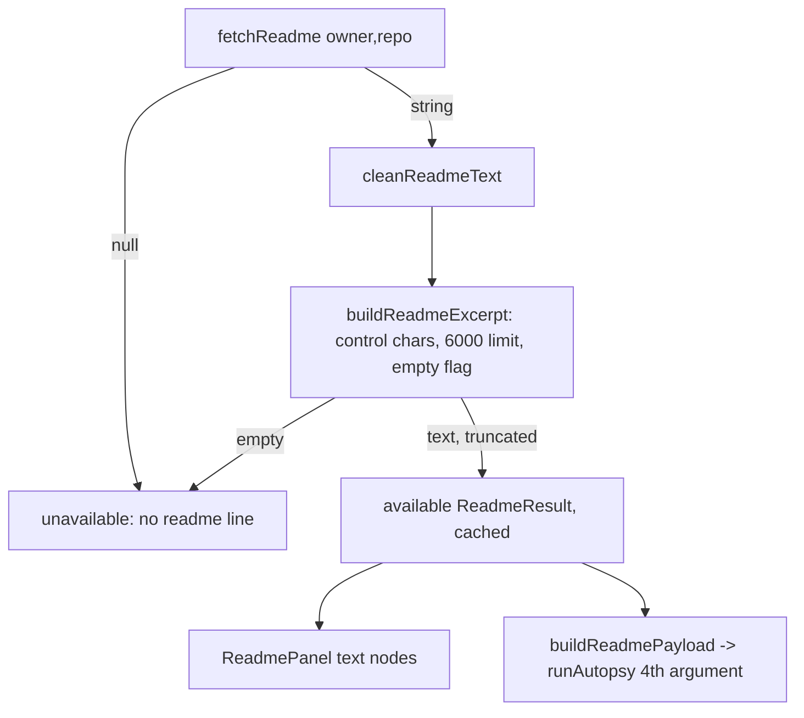

# Design Document

## Overview

This design adds one pure function, `cleanReadmeText`, that removes badges, HTML and link markup from README text before the existing 6000-character excerpt step. The README panel and the AI payload both read the same excerpt, so both get less noise and more real content within the same limit. The output is plain text; nothing is rendered as HTML or Markdown.

The change is one new file in `src/lib`, one new import and one changed line in `src/App.tsx`, one new test file, and appended tests plus one changed assertion in `tests/App.test.tsx`. `buildReadmeExcerpt`, `ReadmeResult`, `ReadmePayload`, the panel, the provider, the schema, `AppState`, the caches, AI Retry and the fallback are untouched. No new dependencies, no backend, no accounts.

**Decision (project owner):** 2 or more consecutive blank lines become exactly 1. `a\n\n\nb` (2 blank lines) becomes `a\n\nb`; `a\n\nb` (1 blank line) is unchanged.

---

## Architecture

### Module Map

| File | Status | Purpose |
|---|---|---|
| `src/lib/readmeClean.ts` | create | Pure: `cleanReadmeText(raw: string): string` |
| `src/App.tsx` | modify | Import `cleanReadmeText`; in `findReadme` change `buildReadmeExcerpt(text)` to `buildReadmeExcerpt(cleanReadmeText(text))` |
| `tests/readmeClean.test.ts` | create | Example tests for every rule, a realistic sample and a pathological-input guard |
| `tests/App.test.tsx` | modify | Append new tests; change one assertion that directly compares README text |

No other file changes. `src/lib/readme.ts` stays byte-identical, so its single property-based test (`tests/readme.pbt.test.ts`) stays valid.

### Requirement-to-component map

| Requirement | Covered by |
|---|---|
| 1.1-1.11 (rules) | `src/lib/readmeClean.ts` |
| 2.1-2.8 (plain text, safety) | `src/lib/readmeClean.ts`, unchanged `ReadmePanel` text nodes |
| 3.1-3.8 (pipeline) | `src/App.tsx` `findReadme`, unchanged `readme.ts` |
| 4.1-4.8 (tests) | `tests/readmeClean.test.ts`, `tests/App.test.tsx` |
| 5.1-5.5 (constraints) | whole design |

### Data Flow



---

## Components and Interfaces

### `src/lib/readmeClean.ts`

Pure, deterministic, never throws. Imports nothing from `src/ui`, `src/github` or `src/ai`.

```typescript
/**
 * Removes HTML, badges and link markup from README text and tidies blank lines.
 * Output is plain text. Not a security measure.
 */
export function cleanReadmeText(raw: string): string
```

Rules, applied in exactly this order:

| # | Rule | Implementation |
|---|---|---|
| 1 | Normalise line endings | `s.replace(/\r\n?/g, '\n')` |
| 2 | Remove HTML comments `<!-- ... -->`, multi-line | small loop with `indexOf('<!--')` and `indexOf('-->', start + 4)`; an unclosed `<!--` is left as is |
| 3 | Remove linked images / badges `[](link)` | `/\[!\[[^[\]]*\]\([^()]*\)\]\([^()]*\)/g` replaced by `''` |
| 4 | Remove images `` | `/!\[[^[\]]*\]\([^()]*\)/g` replaced by `''` |
| 5 | Convert links `[text](url)` or `[text](url "title")` to `text` | `/\[([^[\]]*)\]\([^()]*\)/g` replaced by `$1` (empty text leaves nothing) |
| 6 | Remove HTML tags | `/<\/?[A-Za-z][A-Za-z0-9-]*(?:\s[^<>]*)?\/?>/g` replaced by `''` |
| 7 | Strip leading heading markers | `/^[ \t]{0,3}#{1,6}[ \t]+/gm` replaced by `''` |
| 8 | Trim trailing whitespace on every line | `s.split('\n').map((l) => l.trimEnd()).join('\n')`, so whitespace-only lines become empty |
| 9 | Collapse 2 or more blank lines to 1 | `/\n{3,}/g` replaced by `'\n\n'` |
| 10 | Trim the whole text | `s.trim()` |

Design notes:

- **Deviation from a plain `[^\]]*` / `[^)]*` form, deliberate:** the character classes exclude `[` and `(` / `)` (`[^[\]]*`, `[^()]*`). Without that, an input such as 100000 `[` makes every `[` scan to the end of the string looking for `]`, which is quadratic. With the exclusion each scan stops at the next opener, so the work is linear. The cost is that nested brackets in link text and URLs containing `(` or `)` are not converted (accepted limit below).
- **Rule 2 is a loop, not a regex,** because `/<!--[\s\S]*?-->/g` is quadratic on many unclosed `<!--`.
- **Rule 8 uses `trimEnd` per line,** because `/[ \t]+$/gm` is quadratic on a long run of spaces that is not at a line end.
- **Rule 6 text handling:** only the tag is removed. Text inside `<b>..</b>` or `<script>..</script>` stays as plain text; it is never rendered or executed. Because the tag name must start with a letter and be followed by whitespace, `/` or `>`, `<https://example.com>` (the name `https` is followed by `:`, not whitespace, `/` or `>`) and `a < b > c` (a space follows `<`, not a letter) are left alone.
- **Rule 7 only strips** when the `#` run (1 to 6) is followed by a space or tab. `#hashtag`, `#!/bin/sh` and `####### seven` (7 hashes: the run `#{1,6}` is followed by `#`, not a space, so no match) are unchanged.
- **Rule 9 examples:** `a\n\nb` (1 blank line) is unchanged; `a\n\n\nb` (2 blank lines) becomes `a\n\nb`; 3 and 5 blank lines also become 1. Rule 8 runs first, so lines of only spaces count as blank.
- **Rule order consequences:** `[<b>x</b>](u)` becomes `<b>x</b>` in rule 5 and `x` in rule 6. Two adjacent badges on one line become an empty line (rule 3), which rules 8 and 9 tidy. A README of only badges and tags becomes `''`.

Examples:

| Input | Output |
|---|---|
| `<p align="center">Hi</p>` | `Hi` |
| `[](https://ci.example)` | `` (empty) |
| `See [the docs](https://x.y "Docs").` | `See the docs.` |
| `## Install` | `Install` |
| `#!/bin/sh` | `#!/bin/sh` |
| `a\r\n\r\n\r\n\r\nb` | `a\n\nb` |

### `src/App.tsx` (modify)

In `findReadme`, one changed call and one import:

```typescript
import { cleanReadmeText } from './lib/readmeClean'
// ...
const ex = buildReadmeExcerpt(cleanReadmeText(text))
```

Everything else in `findReadme` is unchanged: `null` text or an `empty` excerpt gives `{ status: 'unavailable', message: 'no readme was left with these remains.' }`; otherwise `{ status: 'available', text: ex.text, truncated: ex.truncated, url: buildReadmeUrl(owner, repo) }`. Consequences:

- The 6000-character limit and the `truncated` flag apply to the cleaned text.
- A README of only badges or HTML cleans to `''`, the excerpt is `empty`, and the existing missing-README line is shown. The report still appears.
- The README cache holds only `available` results, which are now cleaned excerpts. A repeat analysis with different letter case still reuses it.
- AI Retry reuses the held `ReadmeResult` and never refetches, so it sends the same cleaned payload.
- The panel and `buildReadmePayload(readme)` read the same `ReadmeResult.text`, so they always match.

---

## Data Models

None. `cleanReadmeText` takes and returns a `string`. `ReadmeResult` and `ReadmePayload` are unchanged.

---

## Safety

- Output is plain text. `ReadmePanel` keeps rendering the text as a single text node inside a `<pre>`. No Markdown or HTML renderer is introduced and no `dangerouslySetInnerHTML` appears anywhere.
- README text is never written to logs or URLs by this change.
- The cleaner is not a security measure. Instructions hidden in README text (for example in plain sentences) are not removed. The untrusted-data instruction in the AI system instruction stays exactly as is.
- Regexes have no nested quantifiers and are written to avoid quadratic scans, so a hostile README cannot stall the browser. A test guards this.

### Accepted limits (documented, not fixed)

- A URL containing `(` or `)` is not converted or removed as a whole link or image; the markup stays as written.
- Link text containing `[` or `]` is not converted.
- Reference-style links and images (`[text][ref]`, `[ref]: url`) are not handled.
- Fenced code blocks are not treated specially: a `# comment` line inside a code fence loses its `#`, and HTML-looking text inside a fence is removed.
- HTML entities such as `&amp;` stay as written.
- Text between an opening and closing HTML tag is kept.

---

## Error Handling

`cleanReadmeText` has no error paths: every string input returns a string. An unclosed `<!--` or an unmatched `[` is left as written. Fetch failures, rate limits and missing READMEs keep the existing handling in `findReadme`; a README that cleans to nothing uses the existing missing-README line.

---

## Correctness Properties

This spec adds no property-based test. The behaviour is a fixed list of text rewrites, pinned more directly by example tests than by a generator. The statements below hold for all inputs and are checked by the example tests named next to them.

### Property 1: Rules produce the documented output

For any input in the rule tables above, `cleanReadmeText` returns the documented output, including leaving non-matches (`#hashtag`, `#!/bin/sh`, `####### seven`, `<https://example.com>`, `a < b > c`) unchanged.

**Validates: Requirements 1.1, 1.2, 1.3, 1.4, 1.5, 1.6, 1.7, 1.8, 1.9, 1.10, 1.11**

### Property 2: Cleaning is pure and total

For any string input, `cleanReadmeText` returns a string without throwing, returns equal output for equal input, and finishes within a generous time bound for inputs of 100000 characters.

**Validates: Requirements 2.1, 2.2, 2.3, 2.4**

### Property 3: Cleaning happens before the limit

For any README whose raw length exceeds 6000 characters but whose cleaned length is at most 6000, the excerpt is not truncated. For any README that cleans to empty, the missing-README line is shown.

**Validates: Requirements 3.1, 3.3, 3.4, 3.5**

---

## Testing Strategy

Example tests only (Vitest). No property-based tests, no new dependencies. Because `src/lib/readme.ts` is unchanged, the existing `tests/readme.pbt.test.ts` and `tests/readme.test.ts` stay valid and unchanged.

### `tests/readmeClean.test.ts` (new)

- Tags: `` removed; `<p align="center">Hi</p>` gives `Hi`; `<br>` and `<br/>`; a multi-line tag with attributes across lines.
- Comments: single-line and multi-line `<!-- ... -->` removed; an unclosed `<!--` is left as written.
- Images and badges: `` removed; `[](https://ci.example)` removed entirely; two adjacent badges on one line leave an empty line that is collapsed.
- Links: `[text](url)` gives `text`; `[text](url "title")` gives `text`; `[](url)` leaves nothing; `[<b>x</b>](u)` gives `x`.
- Headings: `# Title`, `## Sub`, `###### Six` and a heading indented by 3 spaces lose their markers; `#hashtag`, `#!/bin/sh` and `####### seven` are unchanged.
- Non-matches: `<https://example.com>` and `a < b > c` unchanged.
- Blank lines: 1 blank line unchanged; 2, 3 and 5 blank lines become 1; CRLF input normalised; whitespace-only lines collapsed by the blank-line rule; leading and trailing whitespace trimmed.
- Totals: an input of only badges and tags gives `''`; plain and code-like text without markup is unchanged; two calls with the same input give equal output.
- One realistic sample README (badges, centred HTML logo, headings, links, a code fence) cleaned to an exact expected string.
- Pathological inputs: `'['.repeat(100000)`, `'<a '.repeat(100000)`, `'!'.repeat(50000) + '['`, `'<!--'.repeat(50000)` and `' '.repeat(100000) + 'x'` each return a string in under 1000 ms, measured with `performance.now()`.

### `tests/App.test.tsx` (append and one change)

Appended tests, inside `describe('App readme explainer')`, using the existing mocks:

- A README full of badges, HTML and links is shown cleaned in the README panel, and the 4th argument of `runAutopsy` has the same cleaned text.
- A badges-only README shows `no readme was left with these remains.` once, the report still appears and there is no `role="alert"`.
- A README of 7000 characters raw that cleans to under 6000 (for example 1500 badge lines followed by a few lines of text) is shown without the truncation note, and the payload has `truncated: false`.
- Analysing the same repository again with different letter case with a markup-heavy README calls `fetchReadme` once.

**Existing assertions that directly compare README text** (the only ones allowed to change), found by reading `tests/App.test.tsx`:

| Test | Old expected value | New expected value |
|---|---|---|
| `runAutopsy receives an available payload when the README exists` | payload `text: '# Widget\n\nA tiny library.'` | payload `text: 'Widget\n\nA tiny library.'` |

Existing tests that use the README `'# Widget\n\nA tiny library.'` as mock input but do not compare the full text stay unchanged because they match with the regex `/A tiny library\./` or `/A tiny library/`: `the README panel follows the report and links to the original`, `the overview is shown inside the report, before CAUSE OF DEATH`, `AI Retry reuses the held README: ...` (compares two payloads with each other), `ERROR_AI: no README panel text is shown`, and `analysing the same repo again with different letter case reuses the README cache`. The test `a 7000 character README is shown cut to 6000 ...` uses `'a'.repeat(7000)`, which cleaning leaves unchanged, so its assertions (6000 characters, `truncated: true`) stay as they are. If any other existing assertion would break, implementation stops and reports instead of editing it.
