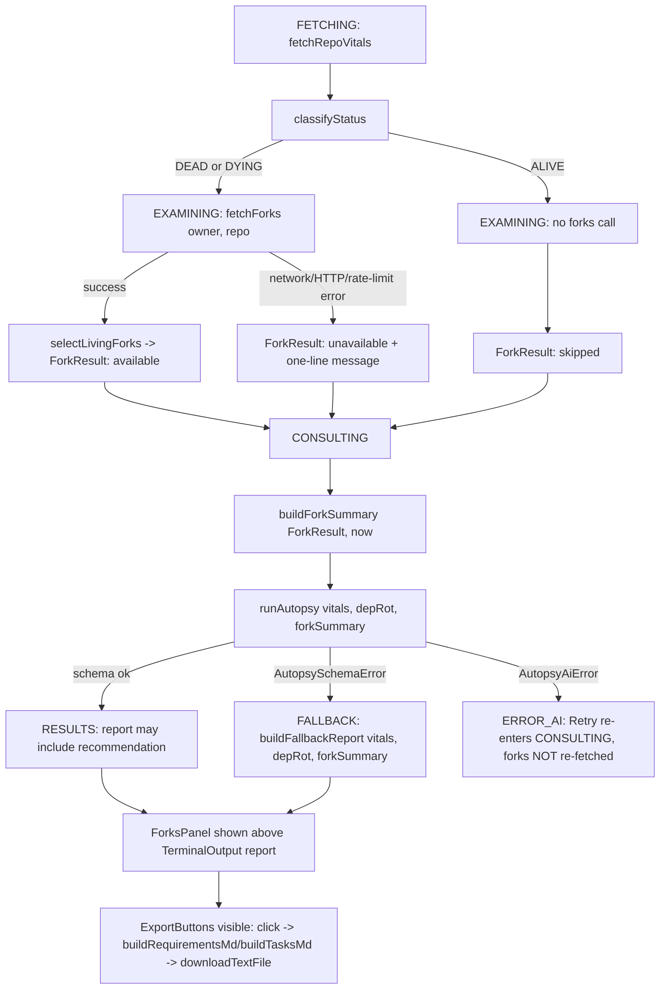

# Design Document

## Overview

This design adds two independent extras on top of autopsy-core, both client-side and both optional in the sense that neither can block the existing autopsy flow:

1. **Living-fork finder** — when a repo is classified DEAD or DYING, Exhume asks GitHub for its forks, keeps up to 3 that look alive and newer than the original, shows them before the plan, and hands a small summary to the AI so the plan can recommend adopting a fork or reviving the original.
2. **Export as Kiro spec** — once a report exists (RESULTS or FALLBACK), two buttons each download one Markdown file (`requirements.md`, `tasks.md`) built deterministically from the report, with no network call.

Both extras are additive: no existing file's public behaviour changes except `runAutopsy`'s prompt (one new key) and `buildFallbackReport`'s signature (one new optional parameter, backward compatible). The state machine, its states, transitions, and the fallback marker line are untouched (Requirement 7.5).

---

## Architecture

### Module Map

| File | Status | Purpose |
|---|---|---|
| `src/lib/forks.ts` | create | Pure: `ForkCandidate`, `LivingFork`, `selectLivingForks`, `monthsSince`, `ForkSummary`, `buildForkSummary` |
| `src/lib/specExport.ts` | create | Pure: `buildRequirementsMd`, `buildTasksMd`, `toSingleLine`, their input types |
| `src/github/forks.ts` | create | Impure: `fetchForks(owner, repo)` — GitHub REST call, maps response to `ForkCandidate[]` |
| `src/ui/ForksPanel.tsx` | create | Renders a `ForkResult`: up to 3 living forks, a one-line message, or nothing |
| `src/ui/ExportButtons.tsx` | create | Renders the two export buttons and a status line, visible only in RESULTS/FALLBACK |
| `src/ui/download.ts` | create | Impure: `downloadTextFile(filename, content)` — Blob + object URL + anchor, one call per click |
| `src/ai/schema.ts` | modify | Add optional `recommendation` object to `autopsyReportSchema` |
| `src/ai/fallback.ts` | modify | `buildFallbackReport` gains an optional third `forks?: ForkSummary` parameter; `AutopsyReport` gains an optional `recommendation` field |
| `src/ai/provider.ts` | modify | `runAutopsy` gains an optional third `forks?: ForkSummary` parameter; prompt gains a `forks` key; system instruction gains one sentence about the optional recommendation and about ignoring forks not in the summary |
| `src/App.tsx` | modify | Fetch forks during EXAMINING when DEAD/DYING, cache and hold the `ForkResult`, pass `buildForkSummary(...)` into `consult`/`runAutopsy`/`buildFallbackReport`, render `ForksPanel` and `ExportButtons`, keep forks out of `handleRetry` |
| `src/ui/theme.css` | modify | Small additions: fork list spacing/link colour reusing existing `--crypt-*` variables |

No other existing file changes. `src/appState.ts`, `src/lib/classifyStatus.ts`, `src/lib/parseRepoUrl.ts`, `src/github/client.ts`, `src/github/deps.ts`, `src/ui/lines.ts`, `src/ui/TerminalOutput.tsx`, `src/ui/VitalsPanel.tsx`, `src/ui/ErrorBanner.tsx`, `src/errors.ts` are untouched.

### Data Flow



---

## Components and Interfaces

### `src/lib/forks.ts`

Pure. Imports nothing from `src/ui`, `src/github` or `src/ai` (Requirement 1.7, 6.7). Defines its own structural types instead of importing from `src/github/forks.ts`.

```typescript
/** A fork as reported by GitHub, trimmed to the fields this feature needs. */
export interface ForkCandidate {
  owner: string
  name: string
  htmlUrl: string
  starCount: number
  lastPushDate: string // ISO 8601
  archived: boolean
}

/** A ForkCandidate that satisfies the Living_Fork test (Requirement 1.3). */
export type LivingFork = ForkCandidate

/** Months between an ISO date and `now`, floor, clamped at 0. Same formula as github/client.ts. */
export function monthsSince(iso: string, now: Date): number

/**
 * Filters to Living_Forks (not archived, < 12 months since last push, last push
 * strictly later than `originalLastPush`), orders by star count descending, then by
 * last push descending, then by owner name ascending (case-insensitive), then caps at 3.
 * Pure and deterministic: same inputs always produce the same output (Requirement 1.6).
 */
export function selectLivingForks(
  forks: ForkCandidate[],
  originalLastPush: string,
  now: Date,
): LivingFork[]

/** The forks step's outcome, held by the app outside AppState. */
export type ForkResult =
  | { status: 'skipped' }
  | { status: 'available'; living: LivingFork[]; inspected: number; livingTotal: number }
  | { status: 'unavailable'; message: string }

/** The no-code, no-commit-message summary sent to the AI (Requirement 3.1-3.3). */
export type ForkSummary =
  | { status: 'available'; livingCount: number; top: Array<{ owner: string; name: string; stars: number; monthsSincePush: number }> }
  | { status: 'unavailable' }

/**
 * Maps a ForkResult to the payload shape for the AI and the fallback report.
 * 'skipped' and 'unavailable' both become { status: 'unavailable' } — never a
 * count of zero for a step that did not actually inspect anything (Requirement 3.2).
 * For 'available' with livingTotal === 0 (inspected, none living), livingCount is 0
 * and top is empty — this IS a real, inspected zero, which is allowed.
 */
export function buildForkSummary(result: ForkResult, now: Date): ForkSummary
```

`monthsSince` and the live-ness check reuse the exact formula already used in `src/github/client.ts` (`Math.floor((now - pushed) / (1000*60*60*24*30.44))`, clamped at 0) so "living" is consistent with `classifyStatus`'s own thresholds. "Later than the original" compares `Date.parse(fork.lastPushDate) > Date.parse(originalLastPush)`.

Total order used by `selectLivingForks` (and by its determinism/ordering property): primary key star count descending; tie-break 1 is last push descending (`Date.parse` comparison); tie-break 2 is owner name ascending via `localeCompare` on the lower-cased owner string; if still tied, input order is preserved (stable sort) so the order is total and deterministic for any input, including duplicate owners.

### `src/github/forks.ts`

Impure. Mirrors the shape of `src/github/client.ts`.

```typescript
import { GitHubRateLimitError } from '../errors'
import type { ForkCandidate } from '../lib/forks'

/**
 * Fetches up to 30 forks of a repository, sorted by stars by GitHub itself.
 * GET https://api.github.com/repos/{owner}/{repo}/forks?sort=stargazers&per_page=30
 * On 403/429: throws GitHubRateLimitError (reused from github/client.ts), reading
 * X-RateLimit-Reset the same way fetchRepoVitals does.
 * On any other non-2xx: throws a generic Error with the status in the message.
 * Unauthenticated; Accept: application/vnd.github+json.
 */
export async function fetchForks(owner: string, repo: string): Promise<ForkCandidate[]>
```

Response mapping: `owner.login` → `owner`, `name` → `name`, `html_url` → `htmlUrl`, `stargazers_count` → `starCount`, `pushed_at` → `lastPushDate`, `archived` → `archived`.

`fetchForks` is called from `App.tsx` only when `classifyStatus(vitals)` is `'DEAD'` or `'DYING'` (Requirement 1.1, 1.2).

### `src/ai/schema.ts` (modify)

Add an optional recommendation object. Existing `revivalStepSchema` and the `steps` array are unchanged.

```typescript
export const forkRecommendationSchema = z.object({
  kind: z.enum(['adopt-fork', 'revive-original']),
  fork: z.string().min(1).optional(), // "owner/name"; required in practice for 'adopt-fork', not enforced by the schema to keep validation simple
  reason: z.string().min(1),
})

export const autopsyReportSchema = z.object({
  causeOfDeath: z.string().min(1),
  severity: z.enum(['critical', 'serious', 'stable']),
  steps: z.array(revivalStepSchema).min(3).max(7),
  recommendation: forkRecommendationSchema.optional(),
})
```

A parsed reply with no `recommendation` key still satisfies `.safeParse` (Requirement 3.5) because the field is `.optional()`.

### `src/ai/fallback.ts` (modify)

```typescript
import type { ForkSummary } from '../lib/forks'

export interface RevivalStep { order: number; action: string; rationale: string }

export interface ForkRecommendation {
  kind: 'adopt-fork' | 'revive-original'
  fork?: string // "owner/name"
  reason: string
}

export interface AutopsyReport {
  causeOfDeath: string
  severity: 'critical' | 'serious' | 'stable'
  steps: RevivalStep[]
  generatedAt: string
  recommendation?: ForkRecommendation
}

/**
 * Unchanged for any call site that omits `forks` or passes a 'skipped'/'unavailable'
 * ForkSummary — output is byte-for-byte identical to the pre-existing 2-arg version
 * (Requirement 3.7). When `forks.status === 'available'` and `forks.top.length > 0`,
 * step 3's action/rationale additionally names `top[0].owner/top[0].name`
 * (Requirement 3.6); orders stay 1, 2, 3 and the step count stays 3.
 */
export function buildFallbackReport(
  vitals: RepoVitals,
  depRot: DepRotReport,
  forks?: ForkSummary,
): AutopsyReport
```

The existing two-argument tests keep passing unchanged because `forks` is optional and the "no mention" branch produces exactly today's three steps.

### `src/ai/provider.ts` (modify)

```typescript
export async function runAutopsy(
  vitals: RepoVitals,
  depRot: DepRotReport,
  forks?: ForkSummary,
): Promise<AutopsyReport>
```

- `buildPrompt` becomes `JSON.stringify({ vitals, deps: depRot, forks: forks ?? { status: 'unavailable' } })`. The existing `tests/provider.test.ts` assertion that prompt keys are exactly `['deps', 'vitals']` is updated to `['deps', 'forks', 'vitals']` (Object.keys on a literal preserves insertion order `vitals, deps, forks`, so the test must sort keys before comparing, as it already does, or the literal order is stated explicitly — either way only this one assertion in that file changes).
- `SYSTEM_INSTRUCTION` gains one sentence: *"If the payload's `forks` field has status `available` and lists at least one fork, you may add an optional `recommendation` field naming one of the listed forks (by `owner/name`) with `kind: 'adopt-fork'`, or `kind: 'revive-original'` with no `fork` field; omit `recommendation` entirely if unsure."*
- After schema validation, `runAutopsy` strips an invented recommendation before returning: if `parsed.data.recommendation?.kind === 'adopt-fork'` and `parsed.data.recommendation.fork` is not one of `forks?.top.map(f => \`${f.owner}/${f.name}\`)` (case-insensitive), the `recommendation` field is dropped from the returned report. This is the single deterministic rule decided for "invented fork": **ignore/strip it**, never shown, never linked. `kind: 'revive-original'` is never stripped (it names no fork).
- Everything else (schema retry, markdown fence stripping, transient backoff, `MAX_ATTEMPTS`, `generatedAt`) is unchanged.

### `src/ui/ForksPanel.tsx`

```typescript
import type { ForkResult } from '../lib/forks'

interface ForksPanelProps {
  result: ForkResult
}

/**
 * 'skipped'   -> renders nothing (Requirement 1.2).
 * 'available' with living.length > 0 -> up to 3 items, each an <a> with
 *   rel="noopener noreferrer" target="_blank", star count, and last push as YYYY-MM-DD
 *   (Requirement 2.1, 2.2).
 * 'available' with living.length === 0 -> one line: "no living forks found among the
 *   graves inspected." (Requirement 2.3), report still renders separately in App.tsx.
 * 'unavailable' -> one line: result.message. No retry button (Requirement 4.4).
 * No timers, no CSS animation classes — identical markup regardless of
 * prefers-reduced-motion (Requirement 2.4).
 */
export function ForksPanel({ result }: ForksPanelProps)
```

Rendered in `App.tsx` from `EXAMINING`/`CONSULTING` onward (as soon as `forkResult` is non-null) and kept visible through `ERROR_AI`, `RESULTS`, `FALLBACK`, placed above the `TerminalOutput` report block so it reads before the plan (Requirement 2.1 "before the plan").

### `src/ui/download.ts`

```typescript
/**
 * Triggers exactly one browser download for `content` as `filename`.
 * Creates a Blob (text/markdown;charset=utf-8), an object URL, a temporary
 * <a download> element, clicks it, then revokes the object URL. No network
 * request (Requirement 5.13, 5.14).
 */
export function downloadTextFile(filename: string, content: string): void
```

### `src/ui/ExportButtons.tsx`

```typescript
import type { ExportableReport, ExportInput } from '../lib/specExport'

interface ExportButtonsProps {
  input: ExportInput
}

/**
 * Rendered by App.tsx only when stage is RESULTS or FALLBACK (Requirement 5.1, 5.2).
 * Two buttons, "Export requirements.md" and "Export tasks.md". Each onClick calls
 * exactly one of buildRequirementsMd/buildTasksMd then downloadTextFile once
 * (Requirement 5.3, 5.4, 5.5), then sets a local `role="status"` line naming the file
 * just exported (Requirement 5.6).
 */
export function ExportButtons({ input }: ExportButtonsProps)
```

### `src/lib/specExport.ts`

Pure. Imports nothing from `src/ui`, `src/github` or `src/ai` (Requirement 6.7); defines its own structural types instead of importing `AutopsyReport`.

```typescript
export interface ExportableStep { order: number; action: string; rationale: string }

export interface ExportableRecommendation {
  kind: 'adopt-fork' | 'revive-original'
  fork?: string
  reason: string
}

export interface ExportableReport {
  causeOfDeath: string
  severity: 'critical' | 'serious' | 'stable'
  steps: ExportableStep[] // 3-7 items, structurally compatible with AutopsyReport
  generatedAt: string
  recommendation?: ExportableRecommendation
}

export interface ExportInput {
  owner: string
  repo: string
  status: 'DEAD' | 'DYING' | 'ALIVE'
  vitals: {
    lastPushDate: string
    archived: boolean
    openIssueCount: number
    starCount: number
    monthsSinceLastPush: number
  }
  report: ExportableReport
}

/**
 * Collapses all whitespace/newlines to single spaces and trims. Then neutralises
 * Markdown line-start constructs that could create an extra list item, heading or
 * checkbox: a leading `-`, `*`, `+`, `#`, `>`, a digit sequence followed by `.` or `)`,
 * and `[ ]`/`[x]` are backslash-escaped; backtick fences (```` ``` ````) are escaped too.
 * If the result is empty, returns the fixed placeholder "(no detail provided)".
 */
export function toSingleLine(text: string): string

/**
 * Builds tasks.md: `# Implementation Plan: <owner>/<repo>`, `## Overview`, `## Tasks`,
 * then exactly one `- [ ] N. <action>` line per step (in step order, action passed
 * through toSingleLine), each followed by one indented `  - <rationale>` line
 * (rationale passed through toSingleLine). No other checkbox or list lines appear.
 */
export function buildTasksMd(input: ExportInput): string

/**
 * Builds requirements.md: `# Requirements Document`, `## Introduction` (one paragraph
 * naming owner/repo, status and cause of death), `## Requirements`, then one
 * `### Requirement N: <action, single line>` per step with a `**User Story:**` line
 * and a `#### Acceptance Criteria` block containing one numbered acceptance
 * criterion built from the step's rationale. When `report.recommendation` exists, an
 * additional final `### Requirement N+1: Resurrection path` section states the
 * recommendation's kind and, if present, the fork (Requirement 5.12).
 */
export function buildRequirementsMd(input: ExportInput): string
```

Determinism: neither function reads `Date.now()`, `new Date()` with no argument, or any RNG; the only date shown anywhere is `input.report.generatedAt`, written verbatim (Requirement 6.2).

**Exact template for `requirements.md`**, so the output is predictable and passes `validate_spec_format`:

```markdown
# Requirements Document

## Introduction

This spec was exported from an Exhume autopsy of {owner}/{repo}, classified {status}.
Cause of death: {causeOfDeath}. Generated {generatedAt}.

## Requirements

### Requirement 1: {toSingleLine(steps[0].action)}

**User Story:** As a maintainer, I want to {toSingleLine(steps[0].action)}, so that the project moves toward revival.

#### Acceptance Criteria

1. THE System SHALL {toSingleLine(steps[0].rationale)}

### Requirement 2: {toSingleLine(steps[1].action)}
...
[one Requirement section per step, in step order]
...

### Requirement {N+1}: Resurrection path            <!-- only when recommendation exists -->

**User Story:** As a maintainer, I want to know whether to adopt a fork or revive the original, so that I choose the cheapest path.

#### Acceptance Criteria

1. THE System SHALL recommend {kind === 'adopt-fork' ? `adopting the fork ${fork}` : 'reviving the original repository'}: {toSingleLine(reason)}
```

---

## Data Models

```typescript
// src/lib/forks.ts
export interface ForkCandidate {
  owner: string
  name: string
  htmlUrl: string
  starCount: number
  lastPushDate: string
  archived: boolean
}
export type LivingFork = ForkCandidate
export type ForkResult =
  | { status: 'skipped' }
  | { status: 'available'; living: LivingFork[]; inspected: number; livingTotal: number }
  | { status: 'unavailable'; message: string }
export type ForkSummary =
  | { status: 'available'; livingCount: number; top: Array<{ owner: string; name: string; stars: number; monthsSincePush: number }> }
  | { status: 'unavailable' }
```

```typescript
// src/ai/fallback.ts (additions)
export interface ForkRecommendation {
  kind: 'adopt-fork' | 'revive-original'
  fork?: string
  reason: string
}
export interface AutopsyReport {
  causeOfDeath: string
  severity: 'critical' | 'serious' | 'stable'
  steps: RevivalStep[]
  generatedAt: string
  recommendation?: ForkRecommendation
}
```

```typescript
// src/lib/specExport.ts
export interface ExportableStep { order: number; action: string; rationale: string }
export interface ExportableRecommendation { kind: 'adopt-fork' | 'revive-original'; fork?: string; reason: string }
export interface ExportableReport {
  causeOfDeath: string
  severity: 'critical' | 'serious' | 'stable'
  steps: ExportableStep[]
  generatedAt: string
  recommendation?: ExportableRecommendation
}
export interface ExportInput {
  owner: string
  repo: string
  status: 'DEAD' | 'DYING' | 'ALIVE'
  vitals: { lastPushDate: string; archived: boolean; openIssueCount: number; starCount: number; monthsSinceLastPush: number }
  report: ExportableReport
}
```

`ForkResult` is held by `App.tsx` in a plain `useState<ForkResult | null>` (initially `null` until the EXAMINING step resolves), separate from `AppState`, plus a `useRef(new Map<string, ForkResult>())` cache keyed by lowercased `owner/repo`, mirroring the existing `vitalsCache`. `AppState` itself is not modified (Requirement 7.5, 7.7).

---

## Correctness Properties

*A property is a characteristic or behavior that should hold true across all valid executions of a system — essentially, a formal statement about what the system should do. Properties serve as the bridge between human-readable specifications and machine-verifiable correctness guarantees.*

### Property 1: Living-fork selection is correctly filtered, capped and ordered

For any list of `ForkCandidate`, any original last-push ISO date, and any reference date `now`, `selectLivingForks` returns at most 3 results; every returned fork is not archived, has fewer than 12 months since its last push relative to `now`, and has a last push strictly later than the original's; and the results are sorted by star count descending, then by last push descending, then by owner name ascending (case-insensitive) for ties.

**Validates: Requirements 1.3, 1.4, 1.5**

### Property 2: Living-fork selection is deterministic

For any list of `ForkCandidate`, any original last-push date, and any reference date, calling `selectLivingForks` twice with the same arguments returns deeply equal results.

**Validates: Requirements 1.6**

### Property 3: Fork panel renders every living fork completely

For any `ForkResult` with status `available` and 1 to 3 living forks, `ForksPanel` renders exactly that many fork entries, and each rendered entry's link has `rel="noopener noreferrer"`, includes the fork's star count, and includes its last push date in `YYYY-MM-DD` form.

**Validates: Requirements 2.1, 2.2**

### Property 4: Fork summary for an available result matches the selected forks

For any `ForkResult` with status `available`, `buildForkSummary` returns a summary with status `available`, `livingCount` equal to the result's `livingTotal`, and a `top` array whose entries mirror the owner, name, star count and months-since-push of the result's `living` forks, in the same order, containing no other fields.

**Validates: Requirements 3.1**

### Property 5: Fork summary for a skipped or failed result is always unavailable

For any `ForkResult` with status `skipped` or `unavailable`, `buildForkSummary` returns exactly `{ status: 'unavailable' }`, never a summary carrying a count field.

**Validates: Requirements 3.2**

### Property 6: Fallback report names the top living fork when one exists

For any `RepoVitals`, any `DepRotReport`, and any `ForkSummary` with status `available` and at least one entry in `top`, the text of `buildFallbackReport(vitals, depRot, forks)` (concatenation of all steps' actions and rationales) contains the string `"{owner}/{name}"` of `top[0]`, and the report still has exactly 3 steps numbered 1, 2, 3.

**Validates: Requirements 3.6**

### Property 7: Exported tasks.md has exactly one checkbox per step, in order

For any `ExportInput` whose `report.steps` has N items where N is 3 to 7, `buildTasksMd(input)` contains exactly N lines matching `^- \[ \] \d+\. `, in step order, and each such line is immediately followed by exactly one line matching `^  - `.

**Validates: Requirements 5.7, 6.3**

### Property 8: Exported requirements.md always contains the fixed skeleton, independent of origin or recommendation

For any `ExportInput` (report with or without a `recommendation`, and regardless of whether the report came from the AI or from `buildFallbackReport`), `buildRequirementsMd(input)` contains the headings `# Requirements Document`, `## Introduction` and `## Requirements`, and contains exactly one `### Requirement` section per step in `report.steps` (plus one more when `recommendation` is present).

**Validates: Requirements 5.8, 5.10, 5.11**

### Property 9: A present fork recommendation is reflected in requirements.md

For any `ExportInput` whose `report.recommendation` is present, `buildRequirementsMd(input)` contains the recommendation's `reason`, and when `kind` is `'adopt-fork'`, contains the `fork` string; when `kind` is `'revive-original'`, contains the word "original".

**Validates: Requirements 5.12**

### Property 10: Export normalisation never breaks the checkbox count and never leaves a blank title

For any step action or rationale text (including embedded newlines and leading Markdown list/heading/checkbox markers such as `- `, `* `, `# `, `1. `, `[ ] `), `toSingleLine` returns a single line with no raw newline character and none of those markers at its start; and for any such text used across all of a report's steps, `buildTasksMd` still contains exactly N checkbox lines for N steps, with no title ever rendered as an empty string (empty-after-normalisation becomes `"(no detail provided)"`).

**Validates: Requirements 6.4, 6.5, 6.6**

### Property 11: Export output is deterministic

For any `ExportInput`, calling `buildRequirementsMd` (respectively `buildTasksMd`) twice with the same input produces byte-identical strings, and the only date appearing in either output is `input.report.generatedAt`.

**Validates: Requirements 6.1, 6.2**

---

## Error Handling

| Failure | Where | Handling |
|---|---|---|
| `fetchForks` rejects (network error, non-2xx, `GitHubRateLimitError`) | `App.tsx`, during EXAMINING, DEAD/DYING only | Caught locally; never rethrown. Produces `{ status: 'unavailable', message }`. For `GitHubRateLimitError`, `message` includes the reset time (`resetAt.toLocaleTimeString()` or similar) and a next action, e.g. "the grave-robbers' ledger is sealed until {time} — try again after then." For any other error, a generic in-theme message, e.g. "could not reach the fork registry. the plan below does not depend on it." Does **not** set `ERROR_GITHUB`/`ERROR_AI`, does not block the transition to CONSULTING (Requirement 4.1-4.3), and `ForksPanel` shows no retry button for this case (Requirement 4.4). |
| AI reply names a fork not present in the supplied `forks.top` | `runAutopsy`, after schema validation | Deterministically stripped: `recommendation` is removed from the returned report before it reaches the UI or the fallback/export path. No error is thrown; this is silent and logged nowhere, matching "no secrets/tokens in logs" scope but also keeping the UI free of invented links. |
| AI reply omits `recommendation` | `autopsyReportSchema.safeParse` | Valid; `recommendation` is `undefined`; UI and export treat it as absent (Requirement 3.5). |
| Export triggered with a malformed or missing field in `ExportInput` | `buildRequirementsMd`/`buildTasksMd` | Not expected in practice — `ExportInput` is always built from a live `AppState` in RESULTS/FALLBACK, which guarantees all fields; no additional runtime validation is added, keeping the functions pure and total over well-typed input (TypeScript enforces the shape at the call site in `App.tsx`). |
| `downloadTextFile` called twice in quick succession (double click) | `ExportButtons` | Each click handler runs its own build-then-download sequence synchronously; nothing is queued or debounced beyond the browser's own click handling, satisfying "at most one download per activation" (Requirement 5.5) — two separate activations legitimately produce two separate single-file downloads, never two files from one activation. |

---

## Testing Strategy

Only two properties are tested with property-based tests (fast-check, at least 100 iterations each). Every other property above is covered by example tests.

**Property-based tests** (two, each tagged `Feature: revival-extras, Property N: <text>`):
- `tests/forks.pbt.test.ts` - Property 1 (living-fork selection: at most 3 results, every result not archived, under 12 months, strictly later than the original, and ordered by stars, then last push, then owner). The fork arbitrary is defined inside this file.
- `tests/specExport.pbt.test.ts` - Property 7 (tasks-equal-steps: for any report with 3 to 7 steps, including step text with newlines and Markdown markers, `buildTasksMd` contains exactly N checkbox task lines). The report arbitrary is defined inside this file.

**Example tests** (Vitest) for the remaining properties:
- `tests/forks.test.ts` - Property 2 (the same input called twice gives equal output), Properties 4 and 5 (`buildForkSummary` for available, skipped, unavailable and available-with-zero results), and `selectLivingForks` examples: archived fork excluded, stale (12 months or more) fork excluded, fork not newer than the original excluded (including an equal timestamp), the 11 vs 12 month boundary, both tie-break levels, cap at 3, input not mutated.
- `tests/forksClient.test.ts` - `fetchForks` with mocked `fetch`: 200 response mapped correctly, request URL contains `sort=stargazers` and `per_page=30`, 403 and 429 throw `GitHubRateLimitError`, 500 throws a generic `Error`.
- `tests/schema.test.ts` - a reply without `recommendation` validates, valid `adopt-fork` and `revive-original` validate, an unknown `kind` is rejected.
- `tests/fallback.test.ts` - Property 6: existing 2-argument cases stay as they are; new cases show the 2-argument result equals the results with `undefined`, `unavailable` and empty-top summaries, and that the top fork's `owner/name` appears when one exists with exactly 3 steps numbered 1, 2, 3.
- `tests/provider.test.ts` - the prompt keys assertion changes to `deps`, `forks`, `vitals`; new cases: the fork summary is sent as given, `forks` defaults to unavailable, a reply without `recommendation` is accepted, a recommendation naming a fork absent from `forks.top` is dropped entirely, a listed fork is kept, `revive-original` is kept.
- `tests/ForksPanel.test.tsx` - Property 3 as example tests: 1, 2 and 3 living forks each show link, `rel="noopener noreferrer"`, star count and `YYYY-MM-DD` date; zero living shows the "none found" line; `unavailable` shows the message and no button; `skipped` renders nothing.
- `tests/specExport.test.ts` - Properties 8 to 11 as example tests: structure of both files, an exported fallback report, byte-identical output on repeat and no date other than `generatedAt`, newline normalisation, Markdown-marker neutralisation, empty text becomes the placeholder, the recommendation is reflected when present and files are valid without it, one Requirement per step plus the final Resurrection path requirement.
- `tests/ExportButtons.test.tsx` - visibility per stage, one status line naming the file after each click, `downloadTextFile` mocked and called exactly once per click.
- `tests/App.test.tsx` - a `vi.mock` setup line for `src/github/forks` is added so existing tests do not call the network (no existing assertion changes); new cases: forks panel appears before the report for a DEAD repo, `fetchForks` is not called for an ALIVE repo, a forks failure shows one message line and the report still appears with no error state, AI Retry does not call `fetchForks` again, `runAutopsy` receives the fork summary, and (export tasks) export buttons render only in RESULTS and FALLBACK.

**Non-regression**: the only existing test assertion that changes is the prompt key set in `tests/provider.test.ts`; the one other edit to an existing test is the `fetchForks` mock setup line in `tests/App.test.tsx`. All other existing tests must pass unchanged (Requirement 7.6).

**Manual verification note**: Requirement 5.9 (files pass the Kiro spec format validator) cannot be exercised from a unit or property test, since the validator is an external tool, not a library import. As part of verifying this feature, one sample `requirements.md` and one sample `tasks.md` generated by the builders are run through `validate_spec_format` by hand and the results are reported to the user; any issues are fixed in the template before this feature is considered done.